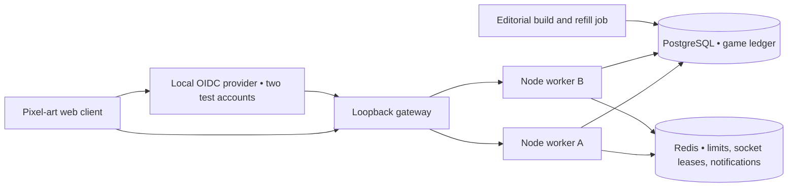
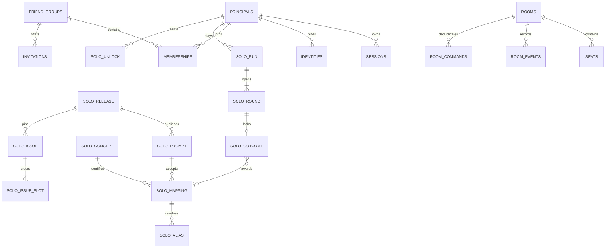

# How Night Culture runs

The default Compose stack runs six detached containers. Its gateway, the two workers and the local issuer share a loopback network namespace. Only the gateway and sign-in ports are published for browsers. Database and cache administration ports are separately bound to loopback. The gateway alternates requests and WebSocket upgrades between workers. A reload can land on either worker. Each worker reconstructs private state from PostgreSQL. A Redis message contains only a room code and wakes the worker's local subscribers after commit. The workers also check ledger versions periodically to recover lost notifications. WebSockets stay on one connection for their lifetime. They require a new authenticated snapshot when reconnecting.

The browser is a dependency-free JavaScript module client with semantic HTML, locally bundled fonts and a low-resolution canvas. All editable labels, scoreboard text and medical terms use the same pixel type system. The server serves files under `web/` through an extension/path allowlist. Content releases, SQL, command receipts and future prompts live outside that directory.

## Data relationships

Migrations include source, topic, tier, alias dispositions, observed-frequency and ranked views, per-player practice history, missing-answer reports, command receipts, histogram cache, revocable group invitations, blocks and bans. Public content, published issues and recorded outcomes are protected by constraints and triggers. Draws for practice and relay exclude reserved prompts. Content publishing checks changed wheels against adjacent already-pinned dates. An invalid refill rolls back. Existing daily issues keep their original IDs, set and scoring release. Run `npm run seed` nightly to keep 35 future days allocated. If inventory runs short, keep serving the durable issues, restore the last valid release, then refill. An unscheduled date returns a service error.

## Solo authority and comparisons

The actor row serializes allocation, claims and commands. One partial unique index permits a single ranked run per player and date. Each round has a unique outcome. The server starts the next clock only on an explicit advance. The application timestamps the complete bounded request before waiting for the database or rate limiter. At or beyond the deadline an open prompt times out. Reveal can be read indefinitely within the daily grace window. The starting Eastern date owns that run through midnight plus ten minutes. During grace, that player must finish or let the run expire before opening its archived replay or explorer. Earlier explorers can withhold an alternative for a live prompt that the player already opened. Their responses do not identify unopened slots. Local display clocks are estimates. Refresh reloads the stored deadline.

Hits use the mapping's stored concept ID, score and fact. An HMAC binds each idempotency key to actor, route and input. The stored response reproduces an identical retry without retaining unknown typed answers. Private missing-term reports retain only text the player deliberately submits. Published runs pair a content release with a scoring release. A practice or archive run has its own history and cannot change streaks or ranked boards. Permanent keepsakes unlock at consecutive-day streaks of 3, 7 and 14.

Named standings require the observer to finish and the subject to opt in with a handle. Private groups compare scores earned while both players belonged to the group. Leave/rejoin starts a new membership interval. A member can block and leave, and an owner can block or remove a member and revoke invites. The server checks group membership, both players’ visibility and the subject’s sharing preference on answer reads. Weekly scores sum the Eastern Monday through the selected day. Eligible totals tie for competition rank, with stable handle ordering inside each tie. The histogram reads the authoritative eligible population and caches a bounded set of distinct totals behind an invalidation counter. “Higher than” divides strictly lower scores by the entire eligible count, including the player. Display begins at 20. The anonymized histogram includes eligible guest scores.

## Relay transitions

A random seven-character code addresses the invitation. Membership authorizes each private read, command and WebSocket handshake. Two to eight distinct player identities share one table. Quick match fills a waiting room and begins once everyone there is ready. An invited host starts explicitly. PostgreSQL serializes transitions under the room row lock. A unique partial index permits one occupied seat per player. A transaction stamps room state, affected seats, ordered events and the successful command receipt together. A single query reads the entire personalized snapshot at one database snapshot. A receipt is scoped to the particular occupancy of that seat. Leaving revokes state-bearing replays. A retried departure returns its empty acknowledgment. The browser fences older versions and preserves input across presence updates.

The holder must submit one unused concept. A pass hands the same prompt to the next living seat by seat number, wrapping to the first. A fresh fuse is uniform over 10–30 seconds. Each pass preserves the remaining fuse with an eight-second minimum. Expiry costs the holder a life, starts a fresh category and hands off to the next survivor. Finding the last available concept rotates the category on that same handoff and costs no life. Client snapshots expose three urgency cues. The fuse, used IDs and answer index stay on the server.

Every accepted pass adds to the passer's life meter. Scores of 10, 15, 30, 60, 85 and 100 add 2, 3, 6, 11, 19 and 24 charge respectively. Five Specialist finds plus a Classic and a Clever reach 100, as do four Specialist and four Student finds. At fewer than three lives, reaching 100 restores one life and leaves any surplus in the meter. A player at three lives can bank 99. Losing a life preserves the bank. A subsequent accepted pass can spend it. Misses, duplicates, stale turns and exact command retries earn no additional charge. Both server and browser read the same tier-to-charge rules. The accepted event records source and destination slots, nominal gain, ending charge, lives and whether the pass granted a life. Room state and the event commit together. [Measured relay load and event replay](../evidence/load/relay-meter.md).

Before starting both updated replicas, stop the previous workers and apply the core migration with `npm run migrate`. It converts each saved focus token into 33 charge once, preserving existing lives. The current seat can be reloaded by either worker. Replaying an older command converts its original receipt to the same display units while preserving its original version. Older events and receipts can lack slot metadata and support text-only history. A new rematch starts every occupied seat at three lives and zero charge.

An authenticated socket heartbeat or visible room read refreshes presence. After 14 seconds a seat shows reconnecting. After 45 seconds unattended seats forfeit. An abandoned room expires without naming a winner. The fuse continues during disconnects. Each worker sweeps due rooms every half second. A worker crash after commit leaves the event recoverable. If the whole service was down more than 30 seconds past an active fuse, it cancels the room. Lobby expiry is 30 minutes of inactivity. Expired room data is collected after one day. An active room cap bounds live inventory. A rematch resets lives, charges and readiness.
