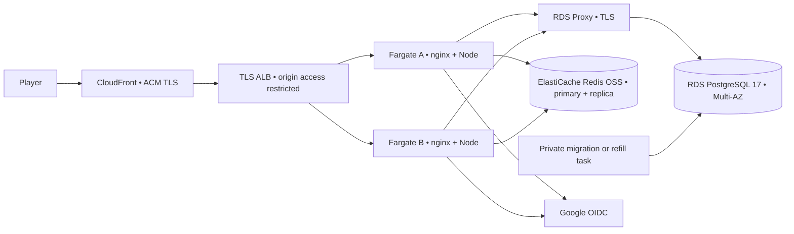

# Manual deployment and rollback

## Target environment

One AWS region, us-east-1, close to the Eastern daily boundary and intended initial audience. This is a deployment design and command sheet. The runnable environment delivered with the game is local.



Run two ECS Fargate ARM64 tasks across two availability zones, each with one vCPU, 2 GiB RAM, a 12-connection Node pool and its own loopback nginx sidecar. Start PostgreSQL on db.m7g.large, 100 GiB encrypted gp3, Multi-AZ, deletion protection and 14 days of automated backups. Require TLS and the regional RDS CA. Use a managed RDS Proxy for workers and the writer endpoint for schema jobs. Start the Redis replication group with two cache.t4g.small nodes, TLS, authentication and noeviction. In the event of CPU credit pressure, move to a fixed-performance node class. Use a new database, Redis namespace, Google registration and secret set for each environment.

Budget planning assumption for 730 hours/month of light regional traffic is roughly USD 450–850/month. Estimate two always-on ARM tasks, two database instances, proxy capacity, two cache nodes, load balancer, storage, network gateways/endpoints, CloudFront egress and logs. Database size, NAT traffic and cross-AZ data dominate the uncertainty. As one explicit line item, an ALB at USD 0.0225/hour plus one average USD 0.008 LCU/hour is about USD 22/month before transfer. Re-price the chosen region, discounts and real traffic mix before authorizing spend. [Fargate](https://aws.amazon.com/fargate/pricing/) · [RDS PostgreSQL](https://aws.amazon.com/rds/postgresql/pricing/) · [ElastiCache](https://aws.amazon.com/elasticache/pricing/) · [ALB](https://aws.amazon.com/elasticloadbalancing/pricing/)

## Provisioning prerequisites

- Use VPC `10.60.0.0/16` with two ALB subnets `10.60.0.0/24` and `10.60.1.0/24`, two private application subnets and separate data subnets. The included nginx real-IP configuration trusts only those ingress ranges. Permit ALB egress to tasks on 8080. Permit task-only access to proxy/Redis and migration-task access to the writer. Keep the databases off public networks. Provide task egress to Google's fixed OIDC endpoints, ECR, logs and secrets.
- Supply DNS control, ACM certificates for the game and origin, a CloudFront distribution, and a TLS ALB target group (IP targets, HTTP on 8080, readiness path `/health/ready`). Restrict the ALB to CloudFront origin-facing IPs and require a secret distribution-origin header on its forwarding rule. Reject other public origin traffic. Set the ALB idle timeout to 90 seconds, deregistration delay to 30 seconds and disable cookie affinity.
- Serve the entire game under one origin. Forward the viewer Host and Origin, query strings, cookies, CSRF and required WebSocket headers on dynamic routes. Use a CloudFront origin request policy that adds the trusted `CloudFront-Viewer-Address` header. nginx strips supplied forwarding metadata and derives the viewer IP from that CloudFront-controlled value. Set default and `/api/*`, `/auth/*`, HTML and health behaviors to caching disabled with zero error-cache TTL. Fonts can cache 24 hours. Cache other public static assets only with explicit versioning or release invalidation. Keep methods GET/HEAD and JSON POST available on dynamic behaviors. Check that private responses never have an Age/cache-hit header. [CloudFront viewer headers](https://docs.aws.amazon.com/AmazonCloudFront/latest/DeveloperGuide/adding-cloudfront-headers.html) · [WebSocket forwarding](https://docs.aws.amazon.com/AmazonCloudFront/latest/DeveloperGuide/distribution-working-with.websockets.html)
- Register a Google web client with the exact HTTPS origin and `https://YOUR-GAME-HOST/auth/callback`. Request openid scope only. A Google account's subject and issuer form the identity key. Set the development issuer variable only on local installations.
- Create ECR repositories for the worker and sidecar, a CloudWatch log group, the ECS cluster, and distinct execution roles authorized to pull images, emit logs and read only the secrets referenced by their task. Use ECR scanning and approve the exact digest. Provision a schema-owning migration login, the restricted runtime login named `night_play`, connection strings, the appropriate database/proxy regional CA chain, Redis URL beginning with `rediss://`, Google secret and a random session HMAC secret of at least 32 bytes. The RDS Proxy endpoint may use ACM roots; include its issuing CA chain in the trusted CA bundle. Keep credentials in Secrets Manager. The application role receives runtime rights through `ops/runtime-grants.sql`. The migration login owns the schema and has grant authority. Never install the local development password into the hosted service.

## Release commands for later authorization

GitHub Actions verifies the game and can package release images inside GitHub. Hosting requires a separate operator decision and cloud credentials. Use the commands below after choosing an account and region, provisioning the infrastructure, and checking the release and staging smoke results. The task-definition generator writes local JSON. [Repository workflows](../.github/workflows/)

```sh
npm ci --ignore-scripts
npm test
export AWS_REGION=us-east-1
export REGISTRY="YOUR_ACCOUNT.dkr.ecr.us-east-1.amazonaws.com"
export RELEASE_TAG="YOUR_REVIEWED_GIT_SHA"
aws ecr get-login-password --region "$AWS_REGION" | docker login --username AWS --password-stdin "$REGISTRY"
docker buildx build --platform linux/arm64 --target production -t "$REGISTRY/penicillion-game:$RELEASE_TAG" --push .
docker buildx build --platform linux/arm64 --target ingress -t "$REGISTRY/penicillion-edge:$RELEASE_TAG" --push .
```

Look up the two immutable digests. Set `GAME_IMAGE` and `EDGE_IMAGE` to the full registry references ending in `@sha256:...`. Export `GAME_ORIGIN`, `GOOGLE_CLIENT_ID`, `GAME_LOG_GROUP`, `GAME_EXECUTION_ROLE`, `MIGRATION_EXECUTION_ROLE`, `APP_DB_SECRET_ARN`, `MIGRATION_DB_SECRET_ARN`, `DB_CA_SECRET_ARN`, `REDIS_SECRET_ARN`, `GOOGLE_SECRET_ARN`, and `SESSION_SECRET_ARN`. Set `CLUSTER`, `SERVICE`, `TARGET_GROUP_ARN` and `DISTRIBUTION_ID`. Prepare a private `network.json` containing ECS awsvpcConfiguration, the approved private subnets, corresponding task security group and assignPublicIp DISABLED. Use the migration security group for the first task.

```sh
node ops/task-definition.mjs migration > migration.json
node ops/task-definition.mjs web > web.json
MIG_REV=$(aws ecs register-task-definition --cli-input-json file://migration.json --query taskDefinition.taskDefinitionArn --output text)
WEB_REV=$(aws ecs register-task-definition --cli-input-json file://web.json --query taskDefinition.taskDefinitionArn --output text)
JOB=$(aws ecs run-task --cluster "$CLUSTER" --launch-type FARGATE --task-definition "$MIG_REV" --network-configuration file://migration-network.json --query 'tasks[0].taskArn' --output text)
aws ecs wait tasks-stopped --cluster "$CLUSTER" --tasks "$JOB"
aws ecs describe-tasks --cluster "$CLUSTER" --tasks "$JOB" --query 'tasks[0].containers[*].[name,exitCode,reason]'
```

Require exit code 0 and a published schedule at least 28 days ahead. The first release creates the service. Subsequent releases update its existing definition after capturing the previous revision.

```sh
aws ecs create-service --cluster "$CLUSTER" --service-name "$SERVICE" --task-definition "$WEB_REV" --desired-count 2 --launch-type FARGATE --network-configuration file://network.json --load-balancers "targetGroupArn=$TARGET_GROUP_ARN,containerName=edge,containerPort=8080" --deployment-configuration 'minimumHealthyPercent=100,maximumPercent=200,deploymentCircuitBreaker={enable=true,rollback=true}'
```

For an existing service, record its current definition and update it.

```sh
PREVIOUS_REV=$(aws ecs describe-services --cluster "$CLUSTER" --services "$SERVICE" --query 'services[0].taskDefinition' --output text)
aws ecs update-service --cluster "$CLUSTER" --service "$SERVICE" --task-definition "$WEB_REV"
```

For either path, wait for both healthy tasks and clear the static cache.

```sh
aws ecs wait services-stable --cluster "$CLUSTER" --services "$SERVICE"
aws cloudfront create-invalidation --distribution-id "$DISTRIBUTION_ID" --paths '/*'
```

Schedule `node scripts/seed.mjs` once per day via EventBridge Scheduler running the migration task definition with that command override. Alert if the last published issue is fewer than 28 days ahead. The job is idempotent and keeps already-issued days fixed. Use the same release command for two independent staging passes against copied fixtures, then on the production data set with no fixture or test accounts. Keep the load generator confined to a separate loopback/staging database and Redis namespace.

## Smoke, operations and recovery

- After migration verify immutable release digest, seven slots on every published issue, no duplicate ranked actor/date, and zero fixture rows in public standings. Open a real guest, confirm both replicas, submit and refresh one round, then try a second session in a private relay. Test a rejected cross-origin POST, personal history isolation and WebSocket upgrade/reconnect after one task drains. On staging, verify the Google redirect, claim/decline, shared NAT limits, p95 targets, TLS chain, redacted logs and CDN private-cache settings. Use staging fixtures for a midnight/DST test.
- Target autoscaling on mean ECS CPU above 60% or sustained memory above 70%, plus per-task socket count/HTTP latency. Start with 2–6 tasks, five-minute scale-in cooldown, at least 2 always healthy. Budget 72 steady worker connections at 6×12 and up to 144 during a 200% rollout, plus administration and jobs. Set and test the proxy/backend cap against actual RDS memory. Alert on pool waiters, DB CPU/locks/free storage, Redis failed writes/memory over 80%, schedule coverage, unhealthy targets, WS reconnect failures and clinical report backlog.
- Graph CloudWatch ALB 4xx/5xx/target latency, ECS CPU/RSS, database and cache service metrics, per-task JSON counters, retry/limiter counts and the server submit histogram. Use a periodic two-seat synthetic in a separate environment to measure receipt-to-peer. Page on 5xx above 1% for five minutes, p95 submit above 300 ms, peer p95 above 500 ms, either service unavailable or no healthy tasks. Keep CDN/ALB logs off or explicitly redact/query-filter callback requests and cookie fields before enabling additional access logging. Limit retention and restrict operator access.
- Use expand/contract schema evolution. Add nullable columns, tables or indexes first; test old and new releases on the expansion, backfill in bounded jobs, deploy new readers/writers, then remove obsolete fields in a later release after the rollback window. Never rewrite a published score or issue. The server catches SIGTERM, marks readiness false, sends WS 1012 and drains HTTP requests. Clients reconnect and recover from PostgreSQL. ECS minimum healthy capacity remains 100%. [ECS deployment settings](https://docs.aws.amazon.com/AmazonECS/latest/developerguide/update-service-parameters.html)
- To roll code back, select the recorded compatible revision and wait for steady service. Invalidate static assets again. Keep durable scores and any newly published content. If an additive schema change needs repair, prefer a reviewed roll-forward migration.

```sh
aws ecs update-service --cluster "$CLUSTER" --service "$SERVICE" --task-definition "$PREVIOUS_REV"
aws ecs wait services-stable --cluster "$CLUSTER" --services "$SERVICE"
aws cloudfront create-invalidation --distribution-id "$DISTRIBUTION_ID" --paths '/*'
```

Quarterly restore drill: capture latest restorable time, restore to a new encrypted private instance, attach the correct parameter/subnet/security groups, and run read-only counts and sample replay comparisons with the source ledger. Verify membership isolation and rebuild the distribution cache. Start a clean Redis namespace, direct an isolated two-task staging service at the restore, repeat a mock failover and record observed RTO/RPO. For a data incident freeze writes, choose the recovery point with the owner, reconcile subsequent immutable receipts, then switch secrets/proxy targets. A restore creates a distinct instance. Never overwrite the live writer during a drill. [RDS point-in-time recovery](https://docs.aws.amazon.com/AmazonRDS/latest/UserGuide/USER_PIT.html)

```sh
aws rds restore-db-instance-to-point-in-time --source-db-instance-identifier "$SOURCE_DB" --target-db-instance-identifier "$DRILL_DB" --restore-time "$RESTORE_UTC" --db-subnet-group-name "$PRIVATE_DB_SUBNETS" --vpc-security-group-ids "$DRILL_DB_SG" --no-publicly-accessible
aws rds wait db-instance-available --db-instance-identifier "$DRILL_DB"
```

A local logical restore rehearsal on 12 November 2026 streamed PostgreSQL's custom-format dump between two fresh disposable databases. It restored 43 issues, 301 slots, 1,565 mappings and all seven outcomes of a completed 70-point test daily. The restored recap matched the original seven rows and scoring revision. The dump/restore stream took 487 ms on the local test machine. Reproduce with `node scripts/verify-restore.mjs` after starting the database and installing the locked host dependencies. The separate hosted drill above exercises managed point-in-time recovery, instance replacement and private-network routing.
